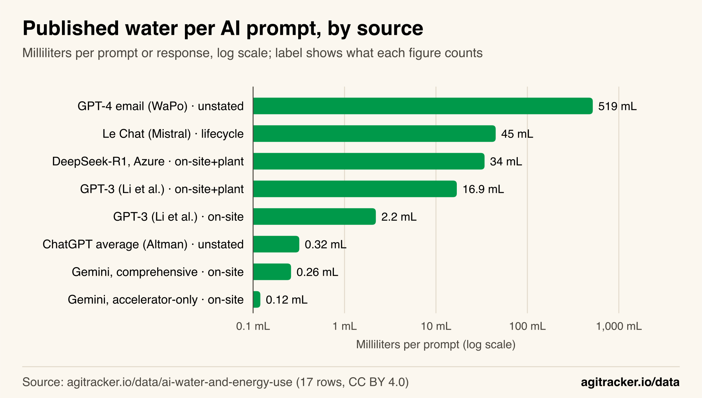
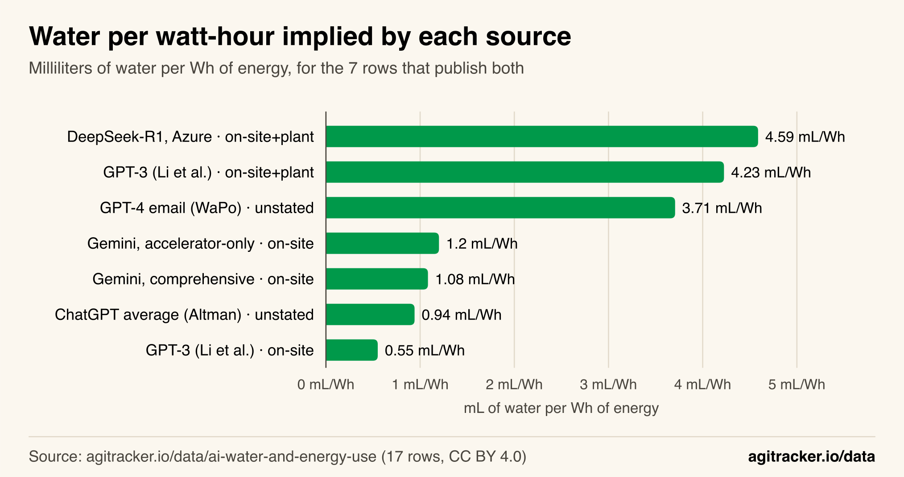
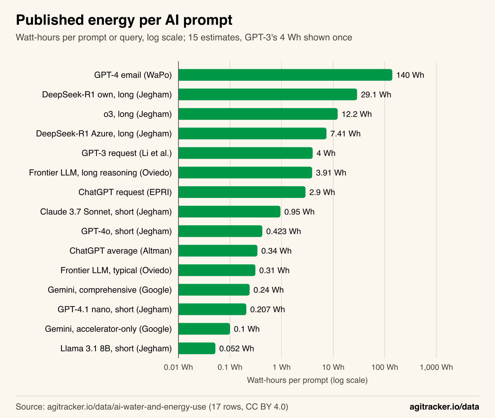
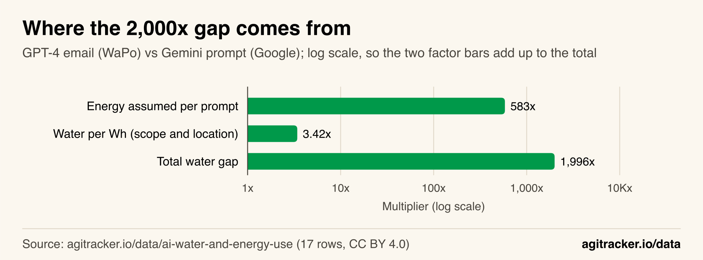
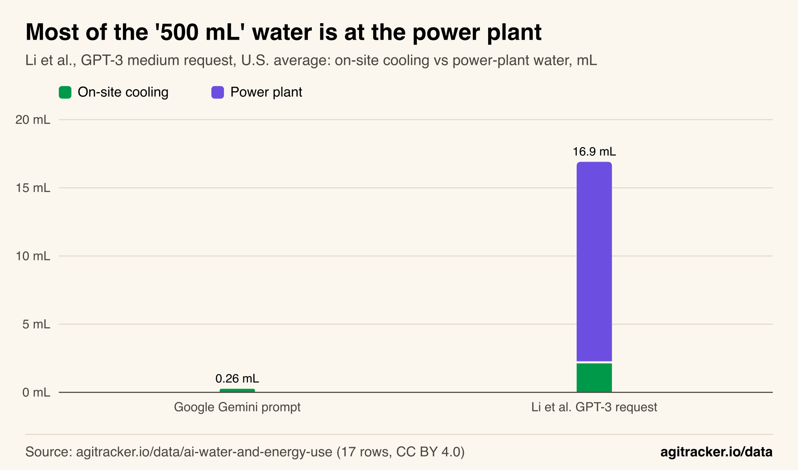
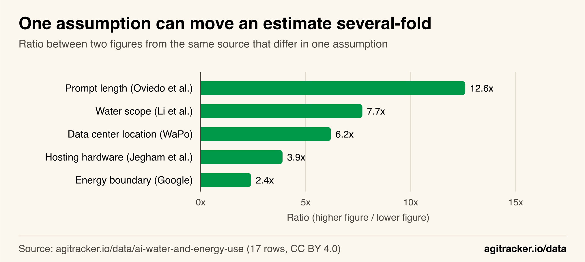

**TL;DR**
- Published per-prompt AI water figures span about 2,000x, from 0.26 mL (Google, median Gemini prompt) to 519 mL (Washington Post, GPT-4 email).
- Water per watt-hour is far more stable: across the 7 figures that report both water and energy it ranges from 0.55 to 4.59 mL/Wh, an 8.3x spread.
- The energy assumed per prompt explains most of the gap: 583x of the 1,996x difference, or 84% on a log scale. The remaining 3.4x comes from scope and location.
- Counting power-plant water multiplies an on-site figure several times: in Li et al.'s GPT-3 example it is 87% of the total (14.7 of 16.9 mL).
- Applying that same power-plant rate to Google's Gemini prompt gives about 1.1 mL, an illustrative calculation that is still 454x below the 519 mL email figure.

How much water does AI use? The published answers for a single prompt range from 0.26 mL to 519 mL, a gap of about 2,000x, and both numbers are widely quoted. This analysis of the 17 published figures in agitracker.io's [AI water and energy dataset](/data/ai-water-and-energy-use/) finds that the disagreement is mostly not about water at all: where a source reports both water and energy, the water per watt-hour varies only about 8x, while the energy assumed for "one prompt" varies about 2,700x.

That changes how the numbers should be read. The question "is AI thirsty?" largely reduces to two others that can be checked: how much electricity a given prompt actually uses, and whether the figure counts the water consumed at power plants. The sections below show each step, with every number reproducible from the dataset's [public CSV](https://agitracker.io/data/ai-water-and-energy-use.csv).

## The Published Figures Span 2,000x

Eight of the 17 rows in the dataset give a water figure per prompt or response. They come from a company disclosure (Google), a CEO blog post (Sam Altman for OpenAI), a lifecycle analysis (Mistral), two research papers (Li et al. and Jegham et al.) and a newspaper estimate (The Washington Post with UC Riverside researchers).

*Figure 1: The eight published per-prompt water figures span more than three orders of magnitude, and they do not all count the same water.*

| Figure | Water per prompt | What it counts |
|---|---:|---|
| Gemini, accelerator-only method (Google) | 0.12 mL | On-site cooling only |
| Gemini, comprehensive method (Google) | 0.26 mL | On-site cooling only |
| ChatGPT average query (Altman) | 0.32 mL | Not stated |
| GPT-3 request (Li et al.) | 2.2 mL | On-site cooling only |
| GPT-3 request (Li et al.) | 16.9 mL | On-site plus power-plant water |
| DeepSeek-R1 on Azure, long prompt (Jegham et al.) | 34 mL | On-site plus power-plant water |
| Le Chat response (Mistral) | 45 mL | Full lifecycle |
| GPT-4, 100-word email (Washington Post) | 519 mL | Not fully stated |

The headline comparison is Google's comprehensive Gemini figure against the Washington Post email: 519 / 0.26 = 1,996x. Including Google's narrower accelerator-only method, the full range is 4,325x. The dataset page shows the same figures with sources in [its first chart](/data/ai-water-and-energy-use/#fig-water-per-prompt).

## Water per Watt-Hour Varies Only 8x

Seven rows publish both a water figure and an energy figure for the same prompt. Dividing one by the other gives the water intensity each source implies: milliliters of water per watt-hour of electricity.

*Figure 2: Once energy is divided out, the seven figures sit within an 8.3x band, and they split cleanly by what water they count.*

| Figure | Water | Energy | mL per Wh | Scope |
|---|---:|---:|---:|---|
| GPT-3 (Li et al.) | 2.2 mL | 4 Wh | 0.55 | On-site only |
| ChatGPT average (Altman) | 0.32 mL | 0.34 Wh | 0.94 | Not stated |
| Gemini, comprehensive (Google) | 0.26 mL | 0.24 Wh | 1.08 | On-site only |
| Gemini, accelerator-only (Google) | 0.12 mL | 0.10 Wh | 1.20 | On-site only |
| GPT-4 email (Washington Post) | 519 mL | 140 Wh | 3.71 | Not fully stated |
| GPT-3 (Li et al.) | 16.9 mL | 4 Wh | 4.23 | On-site plus power plant |
| DeepSeek-R1 on Azure (Jegham et al.) | 34 mL | 7.41 Wh | 4.59 | On-site plus power plant |

Two clusters appear. The three on-site-only figures sit between 0.55 and 1.20 mL/Wh. The two figures that add power-plant water sit at 4.23 and 4.59 mL/Wh. The two figures with an unstated boundary fall one in each cluster: Altman's 0.94 mL/Wh looks like an on-site number, and the Washington Post's 3.71 mL/Wh looks like an on-site-plus-power-plant number.

Google's own value fits this picture. Google's [technical paper](https://arxiv.org/abs/2508.15734) uses a fleet water usage effectiveness of 1.15 liters per kWh, which is 1.15 mL/Wh, close to the 1.08 implied by its published prompt figures.

## Energy Assumptions Explain 84% of the Gap

If water intensity varies 8x but total water varies 2,000x, the rest has to come from energy. The 16 rows with an energy figure range from 0.052 Wh (Llama 3.1 8B, short prompt, Jegham et al.) to 140 Wh (the Washington Post's GPT-4 email), a 2,692x spread.

*Figure 3: The energy assumed for one prompt varies far more than water per watt-hour, so it drives most of the spread in water figures.*

Because water = energy x water intensity, the headline gap splits exactly into two multiplying factors:

- **Energy assumed per prompt:** 140 Wh / 0.24 Wh = 583x.
- **Water per watt-hour:** 3.71 / 1.08 = 3.42x.
- **Product:** 583 x 3.42 = 1,996x, the full gap.

On a log scale, which is how multiplying factors add up, energy accounts for 84% of the gap and water intensity for 16%.

*Figure 4: Read on a log scale, the energy bar covers most of the total; scope and location cover the rest.*

The 140 Wh figure is the main outlier in the energy data. It describes writing one 100-word email with GPT-4 and comes from a press calculation, not a measurement. The next-highest figures are long-prompt reasoning workloads in Jegham et al. (29.1 Wh for DeepSeek-R1 on DeepSeek's own servers, 12.2 Wh for o3), and a peer-reviewed Microsoft study in Joule (Oviedo et al.) puts a typical query on frontier-scale models at a median 0.31 Wh. Readers comparing a viral water number should first ask how many watt-hours it assumed. This site's [AI inference cost explainer](/blog/ai-inference-cost/) covers why the same model's energy and cost per request vary so much with prompt length.

## Power-Plant Water Is Most of the Bigger Numbers

The second factor is scope. Li et al.'s paper, the source of the widely repeated "500 mL bottle" line, reports both scopes side by side. In the paper's words, GPT-3 needs to "drink" a 500 mL bottle of water "for roughly 10 – 50 medium-length responses, depending on when and where it is deployed", which is 10 to 50 mL per response.

*Figure 5: In Li et al.'s U.S.-average row, 87% of the water per request is consumed at power plants, a category Google's per-prompt figure does not count.*

For the U.S. average, Li et al. estimate 2.2 mL of on-site cooling water plus 14.7 mL consumed at power plants, 16.9 mL in total. The power-plant share is 87%, and the total is 7.7x the on-site figure. That ratio alone is larger than the whole 3.42x water-intensity factor in Figure 4, which is why scope matters more than any difference in cooling efficiency between data centers.

**An illustrative calculation, not a measurement.** Li et al.'s figures imply 3.68 mL of power-plant water per watt-hour at the U.S. average. Applying that rate to Google's 0.24 Wh Gemini prompt adds 0.88 mL, for about 1.14 mL in total. Google's grid mix and locations differ from the U.S. average, so this is only a sense of scale: even counted the same way as Li et al., a median Gemini prompt would be about 454x below the 519 mL email figure, because the energy assumption is still 583x lower.

## One Assumption Can Move an Estimate Several-Fold

The dataset includes pairs of figures from the same source that differ in only one assumption. These pairs isolate how much each choice moves the result.

*Figure 6: Each of these single choices moves a per-prompt figure by 2.4x to 12.6x, so two or three of them together can explain differences of 100x or more.*

| Assumption | Pair (same source) | Ratio |
|---|---|---:|
| Prompt length | Oviedo et al.: long reasoning query 3.91 Wh vs typical query 0.31 Wh | 12.6x |
| Water scope | Li et al.: on-site plus power plant 16.9 mL vs on-site 2.2 mL | 7.7x |
| Data center location | Washington Post: Washington state 1,468 mL vs Texas 235 mL per email | 6.2x |
| Hosting hardware | Jegham et al.: DeepSeek-R1 on DeepSeek's servers 29.1 Wh vs Azure 7.41 Wh | 3.9x |
| Energy boundary | Google: comprehensive 0.24 Wh vs accelerator-only 0.10 Wh | 2.4x |

The location row cuts against the headline: the Washington Post's own range for the same email runs from 235 mL to 1,468 mL depending on which state's data center serves it. The single 519 mL figure is one point inside a 6.2x band.

## What the Company Totals Add

Per-prompt numbers describe one request; company reports describe whole fleets. The dataset's [company table](/data/ai-water-and-energy-use/#section-1) lists each company's latest disclosure. Google, for example, reports that its data centers consumed 10,523 million gallons of water in 2025 and withdrew 13,562 million gallons. Those totals cover every workload in the fleet, AI and otherwise, so they cannot be divided into a per-prompt figure without knowing the share of AI traffic, which no company publishes. They are a check on scale rather than a substitute for per-prompt measurement, and they are also scoped differently from one another: Microsoft reports company-wide water, while Google and Meta break out data centers. The broader power picture is in this site's look at [gigawatt AI data centers](/blog/gigawatt-ai-data-centers/), and the role of compute in AI progress is covered in [the three levers behind AI progress](/blog/three-levers-of-ai-progress/).

## How We Did This

- **Data.** All 17 rows of the [AI water and energy dataset](/data/ai-water-and-energy-use/#data), downloadable as [CSV](https://agitracker.io/data/ai-water-and-energy-use.csv). Each row links to its source; the dataset was compiled from company disclosures, papers and press estimates and checked against those sources.
- **Water figures (Figure 1).** Rows with a non-empty `water_ml` value: 8 rows.
- **Water per Wh (Figure 2).** `water_ml / energy_wh` for rows where both are present: 7 rows. Mistral's lifecycle figure has no energy value and is excluded here.
- **Energy figures (Figure 3).** Rows with a non-empty `energy_wh` value: 16 rows. Li et al.'s two GPT-3 rows share the same 4 Wh assumption, so the chart shows it once (15 bars).
- **Gap decomposition (Figure 4).** For two rows A and B: total ratio = (water A / water B) = (energy A / energy B) x (mL per Wh A / mL per Wh B). Log shares are ln(factor) / ln(total).
- **Power-plant water (Figure 5).** Li et al. off-site = 16.904 − 2.2 = 14.704 mL; per Wh = 14.704 / 4 = 3.676 mL/Wh. The illustrative Gemini figure is 0.26 + 0.24 x 3.676 = 1.14 mL.
- **Within-source pairs (Figure 6).** Ratios of the two figures listed in the table. The Washington Post location values (235 mL and 1,468 mL) are recorded in that row's scope field in the dataset.
- **Added classification.** This analysis groups the eight water figures by what they count, based on each row's scope field:

| Figure | Scope group |
|---|---|
| Gemini, comprehensive and accelerator-only (Google) | On-site only |
| GPT-3 on-site row (Li et al.) | On-site only |
| GPT-3 total row (Li et al.) | On-site plus power plant |
| DeepSeek-R1 on Azure (Jegham et al.) | On-site plus power plant |
| Le Chat (Mistral) | Full lifecycle |
| ChatGPT average (Altman) | Not stated |
| GPT-4 email (Washington Post) | Not stated |

- **Excluded.** This analysis does not convert company fleet totals into per-prompt figures or estimate total daily AI water use, because neither the AI share of fleet water nor a verifiable daily prompt volume was available from a primary source that could be checked.

## Limitations

- **Small sample.** Only 8 rows give water and only 7 give both water and energy. The 8.3x band in Figure 2 could widen as more disclosures appear.
- **Mixed methods.** The figures mix company disclosures, a CEO blog post with no method, peer-reviewed papers, a preprint and a newspaper calculation. None of the company figures is third-party verified.
- **Different prompts.** "One prompt" means a median app prompt for Google, an average query for Altman, a medium request for Li et al., a 400-token response for Mistral and a 100-word email for the Washington Post. The decomposition shows how much these choices matter; it does not make the figures equivalent.
- **Unstated boundaries.** Two of the eight water figures do not state their scope. Their placement in the two clusters is an inference from the numbers, not a disclosure.
- **The illustrative figure** in the Power-Plant Water section applies a U.S.-average rate from one paper to another company's prompt. It shows scale only.

## The Takeaway

The most quoted AI water numbers disagree because they answer different questions. Once energy is held fixed, the water per watt-hour is confined to a narrow band, roughly 1 mL/Wh for on-site cooling and roughly 4 to 5 mL/Wh once power-plant water is counted. A per-prompt water figure is therefore mostly a statement about energy: how long the prompt is, what hardware serves it and how much of the data center's overhead is included. The useful questions for any new figure are how many watt-hours it assumes and whether it counts the water used to generate them. The full dataset, with every source, is on the [AI water and energy use page](/data/ai-water-and-energy-use/), alongside the site's other open datasets such as the [AI model release timeline](/data/ai-model-release-timeline/) and the [biggest AI companies by valuation](/data/biggest-ai-companies/).
